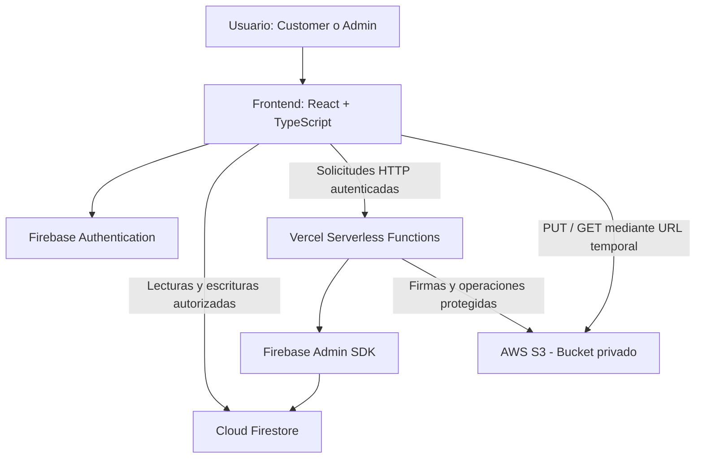

# Papelcorpsac — Sistema de comercio electrónico

**Proyecto Integrador 5 | Desarrollo de Aplicaciones Web**

Papelcorpsac, bajo la identidad comercial **PAPEL CORP**, es una aplicación web de comercio electrónico orientada a la comercialización de artículos de papelería, instrumentos de escritura y suministros de oficina.

El proyecto implementa una aplicación de página única (*Single Page Application*, SPA), desarrollada con React y TypeScript, que integra autenticación, gestión de productos, carrito de compras, órdenes, administración de inventario y almacenamiento privado de imágenes.

**Enlaces del proyecto**

| Recurso | Enlace |
|---|---|
| Aplicación en Production | [papelcorpsac.vercel.app](https://papelcorpsac.vercel.app/) |
| Repositorio | [Papelcorpsac-e-commerce](https://github.com/mllopezc-cmd/Papelcorpsac-e-commerce) |
| Integración continua | [GitHub Actions](https://github.com/mllopezc-cmd/Papelcorpsac-e-commerce/actions) |
| Documentación técnica | [PROJECT.md](docs/PROJECT.md) |
| Seguimiento del desarrollo | [TASKS.md](docs/TASKS.md) |

**Estado:** aplicación desplegada en Vercel y recorridos funcionales principales verificados en Production el 27 de noviembre de 2026.

---

## 1. Descripción del proyecto

Papelcorpsac desarrolla una solución de comercio electrónico que permite a los clientes consultar productos, administrar su carrito y registrar pedidos de demostración.

El sistema también proporciona un panel administrativo para gestionar el catálogo, las existencias y los estados de las órdenes.

La aplicación utiliza servicios en la nube para separar responsabilidades:

- **Firebase Authentication:** autenticación e identificación de usuarios.
- **Cloud Firestore:** persistencia de productos, usuarios y órdenes.
- **AWS S3:** almacenamiento privado de imágenes.
- **Vercel:** despliegue del frontend y ejecución de funciones del servidor.

El proyecto tiene fines académicos. El proceso de compra es **simulado**: no integra una pasarela de pagos ni realiza cargos bancarios.

## 2. Objetivos

### Objetivo general

Desarrollar y desplegar una aplicación web de comercio electrónico que integre una interfaz adaptable, autenticación de usuarios, persistencia de información, gestión administrativa y servicios en la nube.

### Objetivos específicos

1. Implementar una interfaz reutilizable con React y TypeScript.
2. Gestionar autenticación y autorización mediante Firebase.
3. Construir un catálogo con búsqueda, filtros, paginación y detalle de productos.
4. Implementar un carrito con gestión de cantidades y cálculo de importes.
5. Registrar compras simuladas con validación del servidor y actualización de inventario.
6. Permitir que los clientes consulten su historial de órdenes.
7. Proporcionar herramientas administrativas para productos e inventario.
8. Integrar AWS S3 para almacenar y consultar imágenes privadas.
9. Incorporar pruebas automatizadas e integración continua.
10. Publicar y verificar la aplicación en un entorno de Production.

## 3. Alcance funcional

El sistema distingue dos roles principales: **Customer** y **Admin**.

### 3.1. Customer — Cliente

| Módulo | Funcionalidades |
|---|---|
| Autenticación | Registro, inicio y cierre de sesión |
| Catálogo | Consulta de productos publicados |
| Búsqueda | Filtrado por nombre y categoría |
| Productos | Visualización de detalles, precio y disponibilidad |
| Favoritos | Gestión de productos favoritos |
| Carrito | Agregar, retirar y modificar cantidades |
| Checkout | Confirmación de compras simuladas |
| Órdenes | Consulta del historial y detalle de pedidos |

El catálogo contiene una base demostrativa de **60 productos**, distribuidos entre instrumentos de escritura, papelería, artículos de oficina y accesorios de escritorio.

Los usuarios pueden explorar el catálogo sin iniciar sesión. Las funcionalidades que requieren identificación utilizan las protecciones de autenticación correspondientes.

### 3.2. Admin — Administrador

| Módulo | Funcionalidades |
|---|---|
| Acceso | Rutas administrativas protegidas |
| Productos | Creación, edición y eliminación |
| Publicación | Control de visibilidad en el catálogo |
| Inventario | Gestión de precios y existencias |
| Imágenes | Subida y asociación de archivos privados en AWS S3 |
| Órdenes | Consulta de pedidos y gestión de estados |

La administración de órdenes contempla los estados:

- `pending` — Pendiente.
- `processing` — En proceso.
- `completed` — Completada.
- `cancelled` — Cancelada.

Los importes y artículos registrados en una orden son de solo lectura desde el panel administrativo.

### 3.3. Proceso de compra

El checkout implementa un flujo de compra simulada:

1. El cliente selecciona productos y cantidades.
2. El carrito calcula el importe estimado.
3. El usuario autenticado revisa el pedido.
4. El servidor valida los productos, los precios y las existencias.
5. Se registra la orden en Firestore.
6. Se descuentan las unidades correspondientes del inventario.
7. La aplicación muestra la confirmación y limpia el carrito.

La implementación utiliza transacciones de Firestore y mecanismos de idempotencia para proteger la consistencia del proceso.

**Importante:** el sistema no procesa pagos reales ni solicita información de tarjetas bancarias.

## 4. Arquitectura del sistema

La aplicación sigue una arquitectura por capas, separando interfaz, lógica de negocio, acceso a datos y operaciones protegidas del servidor.



### 4.1. Frontend

La interfaz utiliza componentes reutilizables, propiedades tipadas, hooks y rutas gestionadas mediante React Router.

La gestión del carrito se organiza mediante Context API y `useReducer`, separando el estado de las acciones que lo modifican.

### 4.2. Persistencia

Firestore almacena la información comercial del sistema y aplica reglas de seguridad según las operaciones y los permisos correspondientes.

Las operaciones sensibles del checkout se ejecutan en el servidor y no confían en los precios o importes enviados directamente por el navegador.

### 4.3. Backend

Las funciones serverless de Vercel reciben solicitudes HTTP, verifican la autenticación cuando corresponde y ejecutan operaciones protegidas.

Firebase Admin SDK se utiliza exclusivamente en el entorno de servidor.

### 4.4. Almacenamiento de imágenes

AWS S3 almacena imágenes en un bucket privado.

La aplicación utiliza URLs prefirmadas temporales para autorizar operaciones de subida (`PUT`) y visualización (`GET`) sin exponer credenciales de AWS en el navegador.

## 5. Tecnologías utilizadas

| Área | Tecnología | Propósito |
|---|---|---|
| Interfaz | React 19 | Construcción de componentes |
| Lenguaje | TypeScript | Tipado estático |
| Herramienta de desarrollo | Vite | Desarrollo y compilación |
| Navegación | React Router | Enrutamiento SPA |
| Estilos | Tailwind CSS 4 | Diseño y adaptación responsive |
| Autenticación | Firebase Authentication | Gestión de identidad |
| Base de datos | Cloud Firestore | Persistencia de información |
| Operaciones de servidor | Firebase Admin SDK | Validaciones y operaciones protegidas |
| Almacenamiento | AWS S3 | Imágenes privadas |
| Backend HTTP | Vercel Serverless Functions | Endpoints de la aplicación |
| Pruebas | Vitest y React Testing Library | Verificación automatizada |
| Integración continua | GitHub Actions | Controles de calidad |
| Despliegue | Vercel | Alojamiento y ejecución en Production |

Las versiones exactas de las dependencias están definidas en `package.json` y `package-lock.json`.

## 6. Estructura del repositorio

La organización principal del proyecto es la siguiente:

```text
Papelcorpsac/
├── .github/
│   └── workflows/
│       └── ci.yml
├── api/
│   └── ...                 # Funciones HTTP de Vercel
├── docs/
│   ├── PROJECT.md          # Documentación técnica
│   └── TASKS.md            # Seguimiento del desarrollo
├── public/                 # Recursos estáticos
├── scripts/                # Utilidades del proyecto
├── server/                 # Lógica protegida del servidor
├── src/
│   ├── components/         # Componentes de interfaz
│   ├── contexts/           # Contextos de React
│   ├── hooks/              # Hooks reutilizables
│   ├── pages/              # Páginas de la aplicación
│   ├── reducers/           # Gestión de estado
│   ├── services/           # Comunicación con servicios
│   └── types/              # Definiciones TypeScript
├── .env.example            # Referencia de configuración
├── firebase.json           # Configuración de Firebase
├── firestore.rules         # Reglas de Cloud Firestore
├── index.html              # Documento HTML principal
├── package.json            # Dependencias y scripts
├── package-lock.json       # Versiones fijadas
├── vercel.json             # Configuración de Vercel
└── README.md               # Presentación del repositorio
```

Los archivos de pruebas se encuentran junto a los módulos correspondientes.

La estructura puede ampliarse conforme avance la documentación académica de T15.

## 7. Requisitos previos

Para ejecutar el proyecto localmente se recomienda disponer de:

- Node.js 24 y npm.
- Git.
- Un editor compatible con TypeScript.
- Configuración de Firebase para las funciones que utilizan autenticación y Firestore.

Para comprobar las operaciones completas del backend y AWS S3 también se requiere acceso autorizado a los servicios y las variables de entorno correspondientes.

El entorno de integración continua utiliza Node.js 24.

## 8. Instalación y ejecución local

### 8.1. Clonar el repositorio

```bash
git clone https://github.com/mllopezc-cmd/Papelcorpsac-e-commerce.git
cd Papelcorpsac-e-commerce
```

### 8.2. Instalar dependencias

```bash
npm ci
```

Este comando instala las versiones definidas en el archivo de bloqueo `package-lock.json`.

### 8.3. Configurar variables de entorno

El repositorio incluye `.env.example`, que sirve como referencia para configurar los servicios necesarios.

En un terminal compatible con Bash:

```bash
cp .env.example .env
```

Después, completa los valores requeridos para tu propio entorno, siguiendo los nombres incluidos en `.env.example`.

**No publiques el archivo `.env`, credenciales privadas ni claves de cuentas de servicio en GitHub.**

### 8.4. Iniciar el frontend

```bash
npm run dev
```

Vite mostrará en la terminal la dirección local de desarrollo, normalmente `http://localhost:5173/`.

### 8.5. Ejecutar una compilación de producción

```bash
npm run build
```

Para revisar localmente el resultado compilado:

```bash
npm run preview
```

### 8.6. Probar funciones serverless localmente

Las operaciones que dependen de rutas `/api/*` requieren un entorno compatible con las funciones de Vercel.

Para pruebas integradas se puede utilizar Vercel CLI, con el proyecto vinculado y las variables de entorno autorizadas:

```bash
vercel dev
```

`npm run dev` inicia el frontend de Vite; por sí solo no reproduce necesariamente todos los servicios serverless de Production.

La configuración de emuladores debe realizarse únicamente en un entorno local de pruebas.

## 9. Variables de entorno y configuración

La aplicación utiliza dos grupos de configuración.

### 9.1. Frontend

Las variables con prefijo `VITE_` se utilizan en la configuración del cliente, principalmente para conectar Firebase y seleccionar el modo de desarrollo correspondiente.

Entre las configuraciones documentadas se encuentran:

- `VITE_FIREBASE_PROJECT_ID`
- `VITE_USE_FIREBASE_EMULATORS`

Los demás valores deben obtenerse del archivo `.env.example` del repositorio y de la configuración del proyecto Firebase.

Las variables `VITE_` pueden incorporarse al código entregado al navegador. **No deben contener secretos privados.**

### 9.2. Servidor y AWS S3

Las operaciones protegidas utilizan configuración de servidor.

Para AWS S3 se contemplan:

- `AWS_ACCESS_KEY_ID`
- `AWS_SECRET_ACCESS_KEY`
- `AWS_REGION`
- `S3_BUCKET`

La inicialización administrativa de Firebase también requiere la configuración de servidor correspondiente.

Los secretos se administran localmente o mediante las variables protegidas de Vercel y no deben quedar incluidos en el código fuente público.

**Nota:** la instalación local del frontend no implica que estén disponibles automáticamente Firebase Admin, los endpoints protegidos o AWS S3. Cada integración requiere su configuración.

## 10. Pruebas y calidad del software

El proyecto integra pruebas automatizadas, comprobaciones estáticas y verificaciones funcionales.

### 10.1. Comandos disponibles

| Comando | Descripción |
|---|---|
| `npm run dev` | Inicia el frontend de desarrollo |
| `npm run lint` | Ejecuta ESLint |
| `npm run typecheck:api` | Comprueba los tipos del backend |
| `npm run typecheck:seed` | Comprueba los tipos de las utilidades de seed |
| `npm test` | Ejecuta Vitest |
| `npm run build` | Compila TypeScript y genera el build |
| `npm run preview` | Previsualiza el build local |

Para ejecutar las verificaciones principales:

```bash
npm run lint
npm run typecheck:api
npm test
npm run build
```

Las pruebas de integración que requieren Firebase Emulator Suite se ejecutan con su configuración específica. No forman parte necesariamente de la ejecución general.

### 10.2. Integración continua

El proyecto dispone de un flujo de GitHub Actions definido en:

```text
.github/workflows/ci.yml
```

El flujo automatizado ejecuta instalación de dependencias, análisis estático, comprobación de tipos, pruebas, compilación y auditoría de dependencias.

Se activa mediante cambios enviados a `main` y solicitudes de integración dirigidas a esa rama.

### 10.3. Última verificación documentada

**GitHub Actions — CI #12**

| Indicador | Resultado |
|---|---|
| Commit | `1a2b4b4` |
| Estado | Success |
| Archivos de prueba aprobados | 41 |
| Pruebas aprobadas | 659 |
| Pruebas omitidas | 39 |
| Errores de prueba | 0 |
| Despliegue Vercel | Ready |

Las 39 pruebas omitidas corresponden a comprobaciones que no se ejecutan en la suite general bajo esa configuración. No deben interpretarse como pruebas aprobadas ni como fallos.

El resultado de CI acredita los controles automatizados definidos en el workflow. Las pruebas contra servicios reales se documentan por separado.

## 11. Verificación funcional en Production

El 27 de noviembre de 2026 se verificaron recorridos principales en:

**https://papelcorpsac.vercel.app/**

### 11.1. Flujo comercial

Se comprobó la creación y publicación de un producto temporal, su consulta en el catálogo, la incorporación al carrito y la confirmación de una compra simulada.

El resultado incluyó:

- Registro de una orden en Firestore.
- Confirmación de compra por S/ 1.00.
- Estado inicial `pending`.
- Descuento de inventario de 3 a 2 unidades.
- Limpieza del carrito.
- Consulta de la orden desde el historial Customer.
- Visualización de su detalle.
- Consulta de la misma orden desde el panel Admin.

Al finalizar, se eliminaron los registros temporales de prueba, conservando los productos originales.

### 11.2. Integración AWS S3

Se realizaron pruebas efectivas sobre el bucket privado:

| Operación | Verificación |
|---|---|
| PUT | Subida de un archivo desde el panel administrativo |
| GET | Visualización de una imagen asociada a un producto publicado |
| GET — perfiles | Comprobación en catálogo como Admin, visitante y Customer |
| GET — detalle | Visualización en el detalle de un producto |
| DELETE | Eliminación protegida de una imagen todavía no asociada |
| Limpieza | Eliminación manual de una imagen previamente asociada |

La visualización de la imagen se verificó funcionalmente. No se realizó una auditoría independiente de la firma HTTP ni de la caducidad de las URLs prefirmadas.

Al concluir las pruebas, AWS Console mostró cero objetos actuales en el bucket.

### 11.3. Rendimiento y accesibilidad

Se realizaron auditorías Lighthouse sobre el entorno desplegado, con perfiles de escritorio y móvil.

En las ejecuciones posteriores a las correcciones de SEO, el catálogo obtuvo **100 puntos en accesibilidad, buenas prácticas y SEO**.

Las puntuaciones de rendimiento fueron variables y se detectaron oportunidades de optimización, especialmente en carga móvil y estabilidad visual.

Algunas ejecuciones presentaron advertencias de carga incompleta. Por ello, estas mediciones deben interpretarse como resultados puntuales de laboratorio y no como garantías de rendimiento en todos los dispositivos.

Los resultados detallados están registrados en [PROJECT.md](docs/PROJECT.md).

## 12. Seguridad y decisiones técnicas

El sistema aplica mecanismos de protección en distintos niveles:

### Autenticación y autorización

Firebase Authentication identifica a los usuarios.

Las rutas y operaciones protegidas verifican permisos según el contexto y el rol correspondiente. Las funciones sensibles del servidor utilizan Firebase Admin SDK.

### Reglas de Firestore

Las reglas limitan las operaciones sobre los documentos según las condiciones definidas para cada recurso.

### Checkout

El servidor valida los datos comerciales antes de registrar una orden.

Las actualizaciones de stock y la creación de la orden utilizan operaciones transaccionales. También se contemplan mecanismos de idempotencia para reducir solicitudes duplicadas.

### AWS S3

Las credenciales privadas se mantienen en el servidor.

Los archivos se almacenan en un bucket privado y se consultan mediante URLs temporales.

Se distingue entre dos situaciones:

**Imagen no asociada:** ha sido subida, pero ningún producto la utiliza todavía. El administrador puede solicitar su eliminación desde el formulario. El servidor comprueba que no esté referenciada antes de borrarla.

**Imagen asociada:** su clave está registrada en un producto. Se protege su eliminación para evitar que un producto pierda accidentalmente su fotografía.

Al eliminar un producto, la fotografía asociada no se borra automáticamente de S3. Si deja de utilizarse, debe identificarse y retirarse de forma controlada.

Este comportamiento corresponde al diseño implementado y fue comprobado durante T14.

## 13. Despliegue

La aplicación está publicada en Vercel:

**[Abrir Papelcorpsac en Production](https://papelcorpsac.vercel.app/)**

El repositorio GitHub se encuentra conectado al proyecto Vercel y la rama de despliegue es `main`.

El archivo `vercel.json` contempla la navegación de la SPA, permitiendo cargar rutas internas mediante el punto de entrada de React.

La aplicación también incluye una descripción SEO y un archivo `robots.txt` para el rastreo de sus rutas públicas. Estos recursos no sustituyen las restricciones de autenticación ni las reglas de seguridad.

**Último despliegue documental verificado:** commit `1a2b4b4`, estado `Ready`.

## 14. Alcance y limitaciones

Papelcorpsac es una implementación académica funcional, no una plataforma de procesamiento de pagos reales.

Las principales consideraciones de alcance son:

- El pago es simulado y no utiliza cuentas bancarias.
- El catálogo se basa en productos demostrativos.
- Las pruebas automatizadas no sustituyen todas las verificaciones de infraestructura real.
- Determinados escenarios negativos y controles de configuración requieren revisiones adicionales.
- Las imágenes S3 previamente asociadas no se eliminan automáticamente al borrar productos.
- El rendimiento móvil y algunos desplazamientos de diseño siguen siendo oportunidades de mejora.
- El proyecto utiliza React 19; la consigna académica original menciona React 18, diferencia que debe validarse con el docente.

Estas limitaciones se documentan expresamente para distinguir las funcionalidades implementadas de los controles complementarios.

## 15. Documentación técnica y académica

La documentación principal se encuentra en el directorio `docs/`:

| Documento | Descripción |
|---|---|
| [PROJECT.md](docs/PROJECT.md) | Arquitectura, decisiones técnicas, seguridad, pruebas y despliegue |
| [TASKS.md](docs/TASKS.md) | Planificación, tareas, avances y criterios de aceptación |

Como parte de T15 se elaborarán bitácoras académicas de desarrollo y uso de inteligencia artificial. Estos documentos incluirán actividades, decisiones, dificultades, soluciones y evidencias reales.

Los enlaces a las bitácoras se incorporarán una vez que los archivos correspondientes estén terminados.

## 16. Uso de inteligencia artificial

Durante el desarrollo se utilizaron herramientas de inteligencia artificial como apoyo para comprender conceptos, analizar alternativas, revisar implementaciones, proponer pruebas y mejorar la documentación.

Las decisiones finales sobre el código, las configuraciones, las operaciones en la nube y la publicación del repositorio corresponden al desarrollador.

Las respuestas de herramientas de IA se contrastaron mediante pruebas, inspección de resultados y comprobaciones en los servicios utilizados.

El registro detallado de estas actividades se documentará en las bitácoras de T15.

## 17. Autoría y propósito académico

**Proyecto:** Papelcorpsac — PAPEL CORP
**Asignatura:** Proyecto Integrador 5
**Área:** Desarrollo de Aplicaciones Web
**Repositorio:** [mllopezc-cmd/Papelcorpsac-e-commerce](https://github.com/mllopezc-cmd/Papelcorpsac-e-commerce)
**Despliegue:** [papelcorpsac.vercel.app](https://papelcorpsac.vercel.app/)

Este repositorio constituye la implementación y documentación de un proyecto académico de comercio electrónico.

La información de productos y las operaciones comerciales de demostración no representan transacciones financieras reales.
