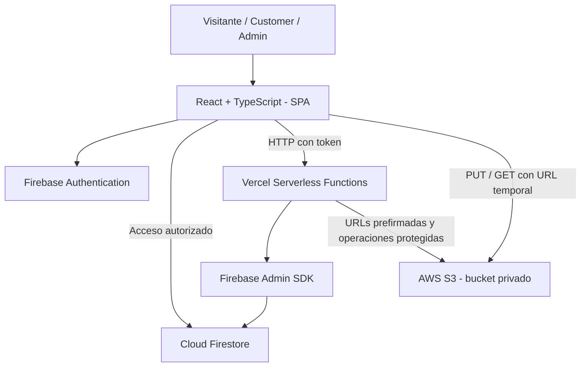

# Papelcorpsac — Sistema de comercio electrónico

**Proyecto Integrador 5 | Desarrollo de Aplicaciones Web**

**PAPEL CORP** es una aplicación web de comercio electrónico para artículos de papelería y suministros de oficina. Implementa un catálogo público, autenticación, carrito, checkout simulado, historial de órdenes y herramientas administrativas, con una arquitectura basada en React, Firebase, AWS S3 y Vercel.

[](https://github.com/mllopezc-cmd/Papelcorpsac-e-commerce/actions/workflows/ci.yml)


> [!IMPORTANT]
> **Demostración pública:** [Acceder a Papelcorpsac en Production](https://papelcorpsac.vercel.app/).
>
> El checkout representa una **compra simulada**. La aplicación no procesa pagos reales ni solicita información de tarjetas bancarias.

### Accesos rápidos

| Recurso | Acceso |
|---|---|
| Aplicación desplegada | [Abrir Papelcorpsac](https://papelcorpsac.vercel.app/) |
| Código fuente | [Repositorio GitHub](https://github.com/mllopezc-cmd/Papelcorpsac-e-commerce) |
| Integración continua | [GitHub Actions](https://github.com/mllopezc-cmd/Papelcorpsac-e-commerce/actions) |
| Documentación técnica | [PROJECT.md](docs/PROJECT.md) |
| Seguimiento del desarrollo | [TASKS.md](docs/TASKS.md) |
| Bitácoras académicas | [Índice de bitácoras](docs/bitacoras/README.md) |
| Bitácora de desarrollo | [Consultar documento](docs/bitacoras/bitacora-desarrollo.md) |
| Bitácora de uso de IA | [Consultar documento](docs/bitacoras/bitacora-ia.md) |

**Estado documentado:** recorridos funcionales principales verificados en Production el 27 de noviembre de 2026. La CI #13 del commit `b38c49f` finalizó satisfactoriamente. La fecha y los resultados corresponden a esa evidencia, no a una supervisión en tiempo real.

---

## 1. Descripción del proyecto

Papelcorpsac es una *Single Page Application* (SPA) responsive para demostrar un flujo comercial completo de papelería: exploración de productos, selección de cantidades, confirmación de pedidos y seguimiento de órdenes.

La solución dispone de dos roles, **Customer** y **Admin**, y separa las operaciones públicas de las administrativas. El catálogo demostrativo está compuesto por 60 productos distribuidos en instrumentos de escritura, papelería, artículos de oficina y accesorios de escritorio.

El propósito es aplicar conocimientos de desarrollo frontend, servicios en la nube, seguridad, pruebas automatizadas y despliegue continuo en un proyecto académico reproducible y documentado.

## 2. Objetivos y alcance

**Objetivo general:** desarrollar y desplegar un ecommerce académico funcional, mantenible y seguro, con gestión de productos, usuarios, órdenes e imágenes almacenadas en la nube.

**Objetivos específicos:**

1. Crear una interfaz responsive con React y TypeScript.
2. Implementar autenticación y controles de acceso por roles.
3. Ofrecer catálogo, búsqueda, filtros, favoritos y carrito.
4. Registrar compras simuladas y actualizar existencias de manera consistente.
5. Proporcionar historial y detalle de órdenes a cada cliente.
6. Permitir la administración de productos, imágenes, inventario y estados de órdenes.
7. Incorporar pruebas, integración continua y un despliegue público verificable.

**Fuera de alcance:** pasarela de pago, cobros bancarios, gestión logística real y operaciones comerciales con dinero real.

## 3. Roles y funcionalidades

### Customer — Cliente

| Área | Capacidades |
|---|---|
| Cuenta | Registro, inicio y cierre de sesión; acceso con credenciales o Google |
| Catálogo | Consulta de productos publicados, búsqueda, categorías y paginación |
| Producto | Detalle, precio, imagen y disponibilidad |
| Favoritos | Gestión de favoritos para usuarios autenticados |
| Carrito | Incorporar o retirar artículos y cambiar cantidades |
| Checkout | Confirmación de una compra simulada con validación del servidor |
| Órdenes | Historial y consulta individual de los pedidos propios |

El catálogo es accesible a visitantes; las funciones personales requieren autenticación según el módulo.

### Admin — Administrador

| Área | Capacidades |
|---|---|
| Acceso | Panel protegido mediante autenticación y validación de rol |
| Productos | Alta, consulta, edición, publicación, despublicación y eliminación |
| Inventario | Modificación de precios y existencias |
| Imágenes | Subida a S3, asociación a productos y eliminación protegida de objetos no asociados |
| Órdenes | Consulta, filtrado y actualización autorizada de estado |

Los estados contemplados para las órdenes son `pending`, `processing`, `completed` y `cancelled`.

## 4. Flujo de compra simulada

1. El cliente selecciona productos del catálogo y los agrega al carrito.
2. El cliente autenticado inicia el checkout.
3. El servidor comprueba los productos, los precios y las existencias vigentes.
4. Una operación transaccional registra el pedido y descuenta el inventario.
5. El sistema devuelve la confirmación y limpia el carrito.
6. La orden puede consultarse desde Customer y gestionarse desde Admin.

Se aplican validaciones de servidor e idempotencia para reducir errores de concurrencia y registros duplicados. El importe indicado es demostrativo y **no implica un cargo real**.

## 5. Arquitectura

La solución separa presentación, identidad, persistencia y operaciones protegidas del servidor.



**Frontend.** React, TypeScript, React Router, Tailwind CSS y componentes reutilizables. El carrito utiliza Context API y `useReducer`.

**Identidad y datos.** Firebase Authentication gestiona la identidad; Cloud Firestore conserva productos, perfiles y órdenes, sujetos a reglas de acceso.

**Backend.** Las funciones de Vercel y Firebase Admin SDK realizan verificaciones privilegiadas y ejecutan la lógica del checkout y las operaciones protegidas de imágenes.

**Imágenes.** AWS S3 conserva objetos privados; Firestore mantiene claves de referencia estables. Las URLs prefirmadas son temporales y no sustituyen las referencias persistentes.

## 6. Tecnologías

| Capa | Tecnología | Responsabilidad |
|---|---|---|
| Interfaz | React 19, TypeScript, Vite | Construcción, tipado y compilación |
| Estilos | Tailwind CSS 4 | Diseño responsive |
| Navegación | React Router | Rutas públicas y protegidas |
| Estado | Context API y `useReducer` | Estado y acciones del carrito |
| Identidad | Firebase Authentication | Inicio de sesión y perfiles |
| Persistencia | Cloud Firestore | Productos, usuarios y órdenes |
| Servidor | Vercel Functions, Firebase Admin SDK | Endpoints y validaciones protegidas |
| Objetos | AWS S3 | Imágenes de productos privadas |
| Calidad | ESLint, Vitest, React Testing Library | Análisis y pruebas |
| Automatización | GitHub Actions | Integración continua |
| Alojamiento | Vercel | Despliegue público |

Las versiones exactas y los scripts se mantienen en `package.json` y `package-lock.json`.

## 7. Organización del repositorio

```text
Papelcorpsac-e-commerce/
├── .github/workflows/   # Integración continua
├── api/                 # Endpoints serverless
├── docs/
│   ├── PROJECT.md       # Arquitectura e historial técnico
│   ├── TASKS.md         # Plan de trabajo y evidencias
│   └── bitacoras/       # Documentación académica independiente
│       ├── README.md
│       ├── bitacora-desarrollo.md
│       └── bitacora-ia.md
├── public/              # Recursos estáticos
├── scripts/             # Utilidades
├── server/              # Lógica protegida del backend
├── src/                 # Interfaz, lógica y pruebas del frontend
├── .env.example         # Referencia de variables de entorno
├── firebase.json        # Configuración Firebase
├── firestore.rules      # Reglas de Firestore
├── package.json         # Dependencias y scripts
└── README.md            # Presentación técnica y académica
```

El subdirectorio `docs/bitacoras/` contiene **solo documentación académica**. No modifica la estructura del código ni se mezcla con `src/`, `api/` o `server/`.

## 8. Requisitos e instalación

### Requisitos

- Git.
- Node.js 24 y npm para reproducir el entorno utilizado por CI.
- Acceso a un proyecto Firebase configurado para las funciones de autenticación y datos.
- Credenciales y permisos autorizados para las integraciones de servidor que se deseen probar.

### Preparación local

```bash
git clone https://github.com/mllopezc-cmd/Papelcorpsac-e-commerce.git
cd Papelcorpsac-e-commerce
npm ci
```

Crea un archivo `.env` a partir de `.env.example` y configura las variables necesarias para tu entorno. En Git Bash:

```bash
cp .env.example .env
```

Para iniciar el frontend:

```bash
npm run dev
```

Para generar y previsualizar el build:

```bash
npm run build
npm run preview
```

**Nota:** `npm run dev` ejecuta Vite, pero no reproduce automáticamente todas las funciones `/api/*`. Para comprobar la integración serverless local se utiliza Vercel CLI con el proyecto vinculado y la configuración apropiada:

```bash
vercel dev
```

No se requiere disponer de las credenciales privadas del proyecto original para leer, evaluar o analizar el repositorio. La reproducción completa de las integraciones necesita servicios configurados y accesos propios.

## 9. Configuración y variables de entorno

El archivo `.env.example` documenta los nombres de las variables necesarias sin incluir secretos de Production.

- **Frontend:** configuración de Firebase y opciones de desarrollo, incluidas las variables con prefijo `VITE_`.
- **Servidor:** configuración de Firebase Admin SDK y de las funciones protegidas.
- **AWS S3:** `AWS_ACCESS_KEY_ID`, `AWS_SECRET_ACCESS_KEY`, `AWS_REGION` y `S3_BUCKET`.

**Reglas de seguridad:**

1. Nunca subir `.env`, claves privadas ni credenciales de cuentas de servicio al repositorio.
2. No usar el prefijo `VITE_` para secretos del servidor, porque sus valores pueden incorporarse al bundle del navegador.
3. Mantener deshabilitados los emuladores de Firebase en Preview y Production.
4. Configurar los secretos del despliegue mediante las variables protegidas de Vercel.

La configuración detallada y las decisiones correspondientes están registradas en [PROJECT.md](docs/PROJECT.md).

## 10. Pruebas e integración continua

### Comandos de verificación

```bash
npm run lint
npm run typecheck:api
npm run typecheck:seed
npm test
npm run build
```

| Script | Objetivo |
|---|---|
| `npm run lint` | Análisis estático con ESLint |
| `npm run typecheck:api` | Comprobación TypeScript del backend |
| `npm run typecheck:seed` | Comprobación TypeScript de utilidades de seed |
| `npm test` | Suite general de Vitest |
| `npm run build` | TypeScript y compilación de Vite |

Las pruebas que necesitan Firebase Emulator Suite se configuran y ejecutan por separado; no deben confundirse con la suite general ni con pruebas en Production.

### Ejecución documentada: GitHub Actions #13

| Indicador | Resultado |
|---|---|
| Commit | `b38c49f` |
| Estado del workflow | **Success** |
| Archivos de pruebas aprobados | 41 |
| Pruebas aprobadas | 659 |
| Pruebas omitidas | 39 |
| Pruebas fallidas reportadas | 0 |
| Duración total | 49 segundos |

**Interpretación:** las 39 pruebas omitidas no son fallos, pero tampoco cuentan como ejecutadas y aprobadas. Esta ejecución confirma los controles del workflow, no todas las integraciones externas en Production.

Consulta el [historial de GitHub Actions](https://github.com/mllopezc-cmd/Papelcorpsac-e-commerce/actions) para comprobar ejecuciones posteriores.

## 11. Verificaciones funcionales en Production

Durante T14 se realizaron recorridos manuales sobre [https://papelcorpsac.vercel.app/](https://papelcorpsac.vercel.app/) y se contrastaron resultados en la aplicación, Firestore y AWS Console.

**Productos y checkout:** se creó y publicó un producto temporal de S/ 1.00 con tres unidades. Un Customer lo incorporó al carrito y confirmó una compra simulada. Se verificaron la orden `pending`, el historial y detalle Customer, la visibilidad desde Admin y la reducción de stock de tres a dos unidades.

**AWS S3:** se verificó una carga `PUT`, la visualización `GET` de una imagen vinculada a un producto publicado en catálogo y detalle, y la eliminación protegida `DELETE` de un objeto no asociado. La visualización se comprobó como visitante, Customer y Admin.

**Limpieza:** se retiraron los productos y la orden temporales; el catálogo volvió a 60 productos. La imagen asociada se eliminó manualmente desde AWS Console después de retirar el producto, y el bucket mostró cero objetos actuales.

**Límites de la verificación:** no se repitieron todos los escenarios negativos de permisos en Production, no se volvió a ejecutar allí el registro de usuarios ni se inspeccionó de forma independiente la firma HTTP de la URL GET. El registro de usuarios sí había sido comprobado previamente durante el desarrollo. Los cambios de estado de órdenes se habían verificado antes del despliegue, no mediante una modificación de estado en este recorrido de Production.

## 12. Seguridad y decisiones técnicas

**Autenticación y roles.** Firebase Authentication identifica usuarios y las rutas administrativas requieren comprobaciones de rol. Las reglas de Firestore y las verificaciones del servidor proporcionan controles adicionales.

**Integridad del checkout.** El servidor valida los datos del pedido y utiliza transacciones para registrar la orden y actualizar existencias. La idempotencia reduce el riesgo de registros duplicados.

**Almacenamiento privado.** El bucket S3 permanece privado; el backend firma URLs temporales para subir o visualizar objetos. Las claves AWS nunca se exponen deliberadamente en React.

**Eliminación segura de imágenes.** La eliminación administrativa de un objeto desde la aplicación comprueba que ningún producto lo referencie. Al eliminar un producto, su imagen asociada **no se borra automáticamente de S3**: es una decisión de seguridad para evitar pérdidas accidentales. Los objetos que dejan de utilizarse requieren limpieza controlada.

**Gestión de cambios.** GitHub Actions automatiza verificaciones y Vercel gestiona el despliegue conectado a `main`. CI, pruebas locales y comprobaciones manuales se registran como evidencias diferentes.

## 13. Despliegue y estado

- **Plataforma:** Vercel.
- **Rama principal:** `main`.
- **URL pública:** [https://papelcorpsac.vercel.app/](https://papelcorpsac.vercel.app/).
- **CI:** [GitHub Actions](https://github.com/mllopezc-cmd/Papelcorpsac-e-commerce/actions).

En el cierre de T14 se confirmó un despliegue Vercel con estado **Ready** para el commit documental `1a2b4b4`. Posteriormente, el commit `b38c49f`, que incorpora el README académico, superó CI #13. No se equiparan estos dos controles ni se presupone un nuevo estado de Vercel sin su verificación.

## 14. Limitaciones y mejoras futuras

- No se integra una pasarela de pagos reales.
- Los productos y pedidos utilizados en las pruebas tienen finalidad demostrativa.
- Persisten oportunidades de optimización de rendimiento móvil y estabilidad visual, identificadas mediante Lighthouse.
- La verificación de seguridad combina pruebas automatizadas, emuladores y recorridos manuales; no equivale a una auditoría externa completa.
- La consigna original menciona React 18 y la implementación utiliza React 19; corresponde validar la diferencia con el docente.
- La limpieza automática de imágenes S3 al eliminar productos no está implementada deliberadamente.

## 15. Bitácora de uso de IA — resumen

La asistencia con IA se utilizó para analizar opciones, revisar implementaciones, proponer pruebas y estructurar la documentación. Las configuraciones sensibles y las verificaciones finales fueron realizadas o autorizadas por el desarrollador.

Se incluyen entradas resumidas y verificables; el desarrollo completo, las decisiones y las limitaciones se conservan en la [bitácora de IA](docs/bitacoras/bitacora-ia.md). Las consultas se describen por tema y **no se presentan como transcripciones textuales**.

| Fecha | Etapa | Consulta o trabajo asistido | Decisión / aprendizaje técnico |
|---|---|---|---|
| 05/11/2026 | T02 | Estructura de interfaz, navegación y estilo corporativo | Reutilizar componentes y adoptar un diseño responsive consistente |
| 10–11/11/2026 | T07 | Validación y consistencia del checkout | Centralizar validaciones, usar transacciones e idempotencia |
| 17/11/2026 | T10.3 | CRUD administrativo y reglas de Firestore | No confiar la autorización solamente a la interfaz |
| 18–20/11/2026 | T10.4 | URLs prefirmadas y operaciones S3 | Mantener el bucket privado y separar PUT, GET y DELETE protegidos |
| 20–21/11/2026 | T11 | Órdenes administrativas y pruebas de permisos | Validar el rol Admin y preservar el historial de Customer |
| 24/11/2026 | T12–T13 | Pruebas, cobertura y CI | Distinguir controles automatizados de integraciones externas |
| 27/11/2026 | T14–T15 | Verificación pública y documentación | Sustentar afirmaciones con evidencia y diferenciar los entornos |

## 16. Documentación y navegación

| Documento | Finalidad |
|---|---|
| [PROJECT.md](docs/PROJECT.md) | Arquitectura, decisiones y evidencias técnicas del desarrollo |
| [TASKS.md](docs/TASKS.md) | Seguimiento de tareas y criterios de aceptación |
| [Índice de bitácoras](docs/bitacoras/README.md) | Punto de acceso a los registros académicos |
| [Bitácora de desarrollo](docs/bitacoras/bitacora-desarrollo.md) | Hitos, verificaciones y decisiones por etapa |
| [Bitácora de uso de IA](docs/bitacoras/bitacora-ia.md) | Consultas, criterios técnicos, decisiones y aprendizajes |

Cada bitácora dispone de enlaces de retorno a su índice y a este README principal. Así se facilita la navegación sin mezclar documentación académica con los módulos de la aplicación.

## 17. Autoría y contexto académico

| Campo | Información |
|---|---|
| Proyecto | Papelcorpsac — PAPEL CORP |
| Asignatura | Proyecto Integrador 5 |
| Área | Desarrollo de Aplicaciones Web |
| Código y documentación | [Repositorio GitHub](https://github.com/mllopezc-cmd/Papelcorpsac-e-commerce) |
| Demostración | [Aplicación desplegada](https://papelcorpsac.vercel.app/) |

Esta documentación corresponde a un proyecto académico y no presenta su checkout como un servicio de pago real.

---

[Volver al inicio del README](#papelcorpsac--sistema-de-comercio-electrónico) · [Consultar las bitácoras](docs/bitacoras/README.md) · [Abrir Production](https://papelcorpsac.vercel.app/)
